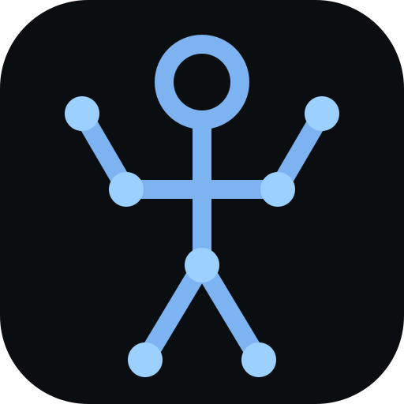

<p align="center">
  
</p>

<h1 align="center">SOLO.</h1>

<p align="center">
  <strong>SOLO Home training</strong><br/>
  Zero noise. Privacy-first workouts — your phone controls the session, your TV shows the board.
</p>

<p align="center">
  Kotlin/Compose Android phone + Android TV · React/Vite phone UX reference · Offline-first · No account · No cloud
</p>

---

SOLO. (**SOLO Home training**) is an open-source home training app. The **product path** is **Kotlin/Compose on Android phone + Android TV** (LAN pairing, on-device DataStore). The React/Vite tree remains a **UX/domain reference** for flows not yet ported (editor, Wger, labs). Build workouts, match weights to your home locker, run live sessions, and review summaries — all on-device. No subscriptions, no vendor backend.

For planned features (Connect IQ reps/velocity, MediaPipe pose, canvas cast pipeline), see **[ROADMAP.md](ROADMAP.md)**.

## The 5 Pillars of SOLO.

Five ideas guide the product. **Now** is what you can use today; **Next** is on the roadmap ([ROADMAP.md](ROADMAP.md)).

| # | Pillar | Now | Next |
|---|---|---|---|
| 1 | **Your gear, your weights** | Locker profiles, overload planner, plate configurator, and TUT when you hit your home weight ceiling | — |
| 2 | **Garmin as live sensor** | Manual recovery slider; native BLE HR on Android (`:ble` + Fake/GATT); web BLE reference | Connect IQ reps/velocity; Health API recovery |
| 3 | **See your form and the workout** | Camera preview on phone (web reference); Android TV Compose HUD via LAN WebSocket | Licensed exercise loops on TV; pose cues on Android phone |
| 4 | **Coach in your ear** | Spoken exercise cues, set-rust vs exercise-rest announcements, pause/resume, male/female voice; HR strain edge pulse + calm coach cue | Velocity-triggered coaching, style options |
| 5 | **Proof on your device** | Session summary, logbook, and ~15s proof reel from workout video clips + stats | — |

Pillar-by-pillar detail: **[ROADMAP.md](ROADMAP.md)**.

## Features

- **Workouts** — create, edit, delete, duplicate, and favorite templates; strength sets or circuit rounds; exercise search (Wger) with import from the editor; markdown **Uitleg** field with preview; Garmin `.fit` import; JSON export/import
- **Home Locker** — multiple locker profiles; equipment inventory drives the overload planner and plate configurator (barbell, dumbbell, kettlebell)
- **Workout Prep** — recovery-aware target weights; TUT progression when locker weight is maxed; prep insights per exercise; multi-workout queue; shared **Voorbereiden** header
- **Live session** — two-phase start (material setup → **Klaar — start workout**); tap-to-complete exercises; sticky active row; set/round progression; automatic per-exercise and phase rest timers; optional front-camera preview on phone with advisory MediaPipe form cues
- **Coach** — Web Speech API announcements for exercise and set transitions; **set rust** vs exercise rest cues; “get ready for next set” after phase rest; first exercise readout when starting a new set; pause/resume lines; male/female voice; rest countdown in the last 5 seconds (toggle in session)
- **Rest overlay** — Full-screen rust / set rust on phone with countdown and the upcoming exercise (name + target)
- **Exercise visuals** — lightweight icon-based visuals today; curated licensed demo loops are planned once asset licenses and attribution are verified
- **History** — completed sessions stored with full summary (set times, trends, sparklines); browse in the logbook, open, delete per entry or clear all; cancelled sessions are not recorded
- **Home** — optional recovery card with manual slider (settings toggle), weekly stats; **Sessie bezig** banner only during a live (started) session
- **Live HR** — optional BLE heart-rate band (Chrome/Edge) from Settings or session controls; BPM on phone control bar
- **Proof reel** — optional ~15s vertical MP4 from session camera clips + stats (FFmpeg in-browser); share or download
- **Themes** — automatic time-of-day themes or manual override in Settings
- **Labs** — isolated feasibility pages for Garmin BLE, pose/camera, canvas compositor, and cast stream (not part of the main session flow)
- **Android phone + TV** — Compose apps under `apps/`; pair over LAN; session drives TV HUD (`TvMessage`)

## Apps & surfaces

| Surface | Location | Role |
|---|---|---|
| Android phone | `apps/android` | Product UX — home, workouts, locker, history, prep, session, summary, pair |
| Android TV | `apps/android-tv` | Living-room HUD (idle / prep / setup / session / rest / summary) |
| Shared domain | `apps/domain` | Session controller, overload, seeds, snapshot models |
| Contracts / transport / BLE | `apps/contracts`, `apps/transport`, `apps/ble` | Wire schema, WebSocket pairing, HR |
| React reference | `src/` | Historical phone UX + labs (not the product TV path) |

## Tech Stack

| Layer | Choice |
|---|---|
| Android phone + TV | Kotlin, Jetpack Compose, Navigation, DataStore, Material 3 |
| Domain / wire | `:domain`, kotlinx.serialization, `contracts/` goldens |
| Transport | OkHttp + Java-WebSocket LAN pairing |
| BLE HR | Android GATT `0x180D` + JVM `FakeBleHrClient` |
| React reference | React 19, Vite, Tailwind — `localStorage` / Web Bluetooth / MediaPipe / FFmpeg labs |
| Release | `foss`/`full` flavors, GitHub `preview` Obtainium APKs; F-Droid + Byte-RB later — [docs/ANDROID_DEVELOPMENT_PLAN.md](docs/ANDROID_DEVELOPMENT_PLAN.md) |

## Getting Started

```bash
npm install
npm run dev
```

```bash
npm run build    # production build (reference)
npm run preview  # preview dist
npm run lint     # tsc --noEmit
```

Product installs: Obtainium → GitHub `preview` release (see Android section below). No cloud server — data stays on-device.

User flows and layout: **[ARCHITECTURE.md](ARCHITECTURE.md)**.

## Privacy & security

- [PRIVACY.md](PRIVACY.md) — local-first policy (linked from F-Droid Fastlane copy)
- [SECURITY.md](SECURITY.md) — reporting + GitHub hardening
- [CHANGELOG.md](CHANGELOG.md) — Keep a Changelog + store notes

## Android (Compose) + Obtainium

Kotlin + Jetpack Compose on **Android phone + Android TV** (phone controls TV on LAN). **iOS dropped.** React/Vite is reference only until native parity covers editor/labs.

Early device installs: **GitHub Releases + Obtainium** (floating `preview` pre-release on `main`). F-Droid/`foss` Byte-RB is Phase 8+.

```bash
cd apps
./gradlew :domain:test :android:assembleFossDebug :android-tv:assembleFossDebug
```

- Stack research: **[docs/native-android-stack.md](docs/native-android-stack.md)**
- Release + Obtainium: **[docs/RELEASING.md](docs/RELEASING.md)**
- Development plan: **[docs/ANDROID_DEVELOPMENT_PLAN.md](docs/ANDROID_DEVELOPMENT_PLAN.md)**
- F-Droid kit (later): **[metadata/FDROID_SUBMISSION.md](metadata/FDROID_SUBMISSION.md)**
- Agents: **[AGENTS.md](AGENTS.md)**

## License

MIT. See [LICENSE](LICENSE).

---

*Built for the sovereign home athlete. Architecture in [ARCHITECTURE.md](ARCHITECTURE.md) · Future phases in [ROADMAP.md](ROADMAP.md).*
