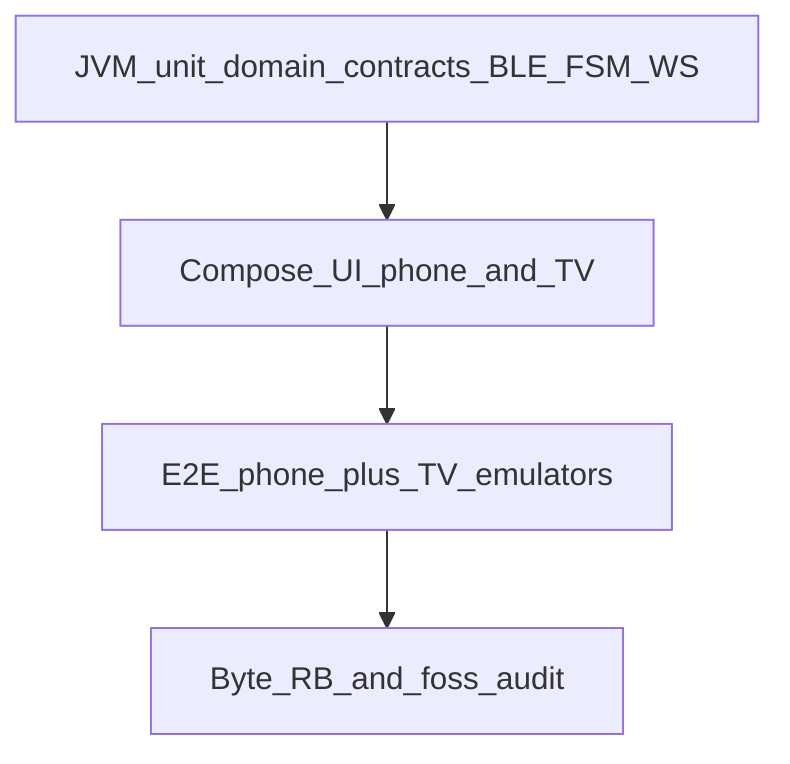

# SOLO Home training — Android development plan

Implementation plan derived from [native-android-stack.md](native-android-stack.md).

**Scope:** Kotlin/Compose **phone** + **Android TV** companion, F-Droid/`foss` + GitHub, **Byte-RB required**.

**Out of scope:** iOS, Capacitor, Play Store, Cast in `foss`, browser/web TV of any kind.

Related: [RELEASING.md](RELEASING.md) · [metadata/FDROID_SUBMISSION.md](../metadata/FDROID_SUBMISSION.md) · [AGENTS.md](../AGENTS.md)

---

## Locked product decisions

| Topic | Decision |
| --- | --- |
| Phone | Kotlin + Jetpack Compose (`net.moonbaseone.solo`) |
| TV | **Android TV Compose app only** (`net.moonbaseone.solo.tv`), phone-controlled over LAN |
| Web `/tv` | **Gone** — route, BroadcastChannel transport, and connect UX deleted from the React app |
| React/Vite | Phone UX/domain **reference only** (`src/lib/coach`, `src/lib/exercise`, session/prep flows) |
| iOS | Out of scope |
| Byte-RB | Required for every F-Droid `foss` listing |
| Flavors | `foss` (F-Droid + GitHub) / `full` (GitHub only) |

There is **no** interim browser TV path. Pairing and HUD ship only when the Android TV app exists.

---

## Goals (v1 `foss`)

1. Phone app: core flows (home, locker skim, prep, session, summary).
2. Android TV app: live HUD driven by phone (pair + WebSocket).
3. Native BLE HR (`0x180D`) with graceful degrade.
4. Dual APKs, no GMS/Cast in `foss`.
5. CI: unit + UI + E2E (phone↔TV emulators) + **Byte-RB** before F-Droid MR.

Non-goals v1: pose/proof reel, Connect IQ, Health Connect, Chromecast, any web TV surface, Cast-based living-room board.

---

## Proposals (accepted into this plan)

| # | Proposal | Status |
| --- | --- | --- |
| P1 | Vertical slices: contracts → pair → one session message on TV → grow UI | **Done** (through Phase 6) |
| P2 | Compose TV is the only receiver; React never hosts TV again | **Done** |
| P3 | Keep web at repo root until Android skeleton exists | **Done** (skeleton + phone core ship; `src/` still reference) |
| P4 | Contract-first goldens in `contracts/` (schema from product needs; deleted `broadcast.ts` is historical only) | **Done** |
| P5 | Fake BLE + fake WS in CI; real BLE = release checklist | **Done** (CI fakes; real band = tag checklist) |
| P6 | E2E: phone + Android TV emulators (Maestro preferred) | **Partial** (loopback WS + Maestro scaffold; dual-AVD later) |
| P7 | Byte-RB blocking on `v*` tags; nightly on `main` | **Open** (Phase 8) |
| P8 | TV listens / phone dials (pair code on TV) | **Done** |

---

## Target layout

```text
contracts/                 # JSON Schema + golden fixtures (phone↔TV messages)
apps/contracts/            # Kotlin codecs
apps/domain/               # Pure JVM domain (session, overload, seeds, TvMessage factory)
apps/transport/            # Pairing + WebSocket
apps/ble/                  # HR parser + FakeBleHrClient
apps/android/              # phone Compose app (DataStore snapshot)
apps/android-tv/           # Android TV HUD
src/                       # React phone UX reference (delete after full parity)
tool/fdroid_build.sh
tool/verify_reproducible.sh
```

---

## Phased delivery

Each phase = one or few PRs. **No merge without its test gate.**

### Phase 0 — Docs + web TV removal — **Done**

- Stack research + this plan: Android TV only.
- Web `/tv`, BroadcastChannel, connect UX, and `tv` i18n removed.
- AGENTS / README / ROADMAP / ARCHITECTURE aligned to phone reference + planned Android TV.

**Gate:** React lint/build green; no product path to a browser TV board.

### Phase 1 — Android skeleton + CI + early GitHub Releases — **Done**

- Gradle: phone + TV shells, `foss`/`full`, `LEANBACK_LAUNCHER` on TV.
- Pin JDK 21 / AGP / Kotlin; `dependenciesInfo.includeInApk = false`.
- `android-ci.yml`: unit smoke + assemble `fossDebug`.
- `build-release.yml` (Kinetic-style): assemble `fossRelease`, publish installable APKs to GitHub Releases for **Obtainium** — floating `preview` pre-release on `main`, versioned `v*` later. **Not F-Droid** for early device testing.

**Gate:** assemble both apps; no GMS on `foss` classpath; preview APKs installable via Obtainium.

### Phase 2 — Contracts + codecs — **Done** (PR C)

- Author `contracts/tv-messages.schema.json` + goldens (`idle`, `prep`, `setup`, `session`, `summary`, `rest`).
- Kotlin codecs in `apps/contracts` (`schemaVersion`, reject unknowns); phone + TV depend on `:contracts`.
- JVM golden round-trip tests in CI (`:contracts:test`).

**Gate:** JVM encode/decode all goldens; version bump required on breaking change.

### Phase 3 — Transport + pairing (slice A) — **Done** (PR D + E)

- `apps/transport`: pair payload `{host,port,nonce,schemaVersion}`, hello/welcome handshake, fake duplex + OkHttp/Java-WebSocket.
- TV listens (WebSocket); phone dials; on-screen pair code + payload JSON (QR later).
- CI pair smoke: fake sockets **and** real loopback OkHttp ↔ Java-WebSocket (`RealWebSocketPairingSmokeTest`).
- Maestro scaffold under `e2e/` for local dual-emulator; full dual-AVD CI later.
- mDNS optional later.
- Phone UX: pair sheet only (no web fallback).

**Gate:** fake + real loopback pair smoke green in CI; Maestro dual-emulator optional locally.

### Phase 4 — BLE HR (phone) — **Done** (PR F)

- `apps/ble`: HR measurement parser (0x2A37), FSM, `FakeBleHrClient`, `tvSensorFromHr`.
- Phone: `AndroidBleHrClient` (`BluetoothGatt` + 0x180D scan) + Fake HR smoke buttons.
- Session HUD can push live BPM into `TvMessage.Session.sensor` when paired.

**Gate:** FSM + parser unit tests; fake client instrumented in JVM CI; manual real-band checklist before public tag.

### Phase 5 — TV HUD (slice B) — **Done** (PR G)

- Compose HUD from `TvMessage` only: idle / prep / setup / session / rest / summary.
- Live WebSocket messages swap pair shell → `TvHudScreen`.
- Port visual intent from old web TV mockups (dark living-room board), not a live web route.

**Gate:** JVM mode-routing tests; Compose UI tests for idle + rest (instrumented); fuller E2E with phone later.

### Phase 6 — Phone core UI — **Done** (PR H)

- Nav → workouts → locker → prep → session → summary/history.
- `:domain` with seeds, overload planner, session controller, `TvMessage` factory + JVM tests.
- Pair entry points in Settings / Prep / Session; live HUD push when paired.

**Gate:** domain unit tests in CI; phone assemble green; TV-connected path via existing transport.

### Phase 7 — Persistence + polish — **Done** (PR H)

- DataStore JSON `SoloSnapshot` (workouts, locker, history, active session, prep).
- Process-death policy: restore `activeSession` on cold start (`ProcessDeathPolicy` + restore test).
- Material 3 Solo theme (charcoal + mint). TV D-pad polish can grow later.

**Gate:** snapshot JSON round-trip; restore-after-death clears expired rest.

### Phase 8 — Release + Byte-RB

- Real `fdroid_build.sh` + `verify_reproducible.sh`.
- Tag workflow: signed `foss` APKs (phone + TV) + RB compare.
- Fastlane screenshots for phone and TV; metadata for `.tv`.

**Gate:** bit-identical rebuilds (sig rules per F-Droid RB); foss audit.

### Phase 9 — F-Droid

- Only after Phase 8 green on a tag.
- Separate listings (or clear dual-APK story) for phone + TV as F-Droid policy allows.

### Phase 10 — Product parity (React → Compose) — **In progress**

Goal: enough native phone UX that `src/` can be deleted. Vertical PRs; each removes or retires a React surface when done.

| Slice | Port | Unlocks deleting |
| --- | --- | --- |
| **P1** | Workout CRUD + editor (create / edit / delete / favorite) | `WorkoutEditorPage`, builder parts |
| **P1** | Locker CRUD (add / edit / delete items) | `LockerPage` forms |
| **P2** | Prep polish (insights, plate cues) + multi-queue UX | prep panels |
| **P3** | Session polish (rest overlay, undo, pause, sticky active) | session chrome |
| **P4** | Summary / history detail (trends) | rich summary |
| **P5** | Settings themes + coach TTS (Android speech) | coach / theme stores |
| **P6** | Wger search import + FIT import (optional) | Wger / FIT modules |
| Later | Camera / pose / proof reel | labs — still non-goals for early foss |

**Gate per slice:** domain unit tests where logic moves; Compose smoke; update ROADMAP checklist; only then delete matching `src/` trees.

---

## Testing strategy



| Layer | Tools | Cover |
| --- | --- | --- |
| Unit | JUnit, coroutines-test | Domain, codecs, WS framing, BLE FSM |
| UI | Compose UI Test | Session controls; TV modes from fixtures |
| E2E | Maestro (proposal) | Pairing, session→TV HUD, disconnect, phone-only |
| RB | `verify_reproducible.sh` | Tags + nightly |

### Minimum E2E scenarios

1. Pairing happy path  
2. Wrong code / schema mismatch  
3. Session drives TV (start / set complete / rest)  
4. Disconnect + reconnect  
5. Phone-only workout (TV optional)  
6. Fake HR → phone + TV strip  

### Not automated in v1

Real BLE hardware, real living-room Wi‑Fi quirks, Cast/`full`, pixel-perfect TV art.

---

## PR sequencing

| PR | Focus | Phase | Status |
| --- | --- | --- | --- |
| A | Docs + web `/tv` removal | 0 | **Done** |
| B | Android Gradle skeleton + GitHub/`preview` Obtainium releases | 1 | **Done** |
| C | Contracts + codecs | 2 | **Done** |
| D | Pairing + WebSocket | 3 | **Done** |
| E | E2E pair smoke (loopback WS + Maestro scaffold) | 3 | **Done** |
| F | BLE + fakes | 4 | **Done** |
| G | TV HUD | 5 | **Done** |
| H | Phone UI + DataStore persistence | 6–7 | **Done** |
| P1… | Product parity slices (editor, locker, session polish, …) | 10 | **This PR** (P1) |
| R | Signing + Byte-RB | 8 | Deferred while parity runs |
| F-Droid | fdroiddata | 9 | After R |

---

## Immediate next step

**Phase 10 / product parity** before Phase 8: port workout + locker CRUD first, then session/prep polish, then retire matching React `src/` trees. Byte-RB / F-Droid wait until the product shell is usable day-to-day.
